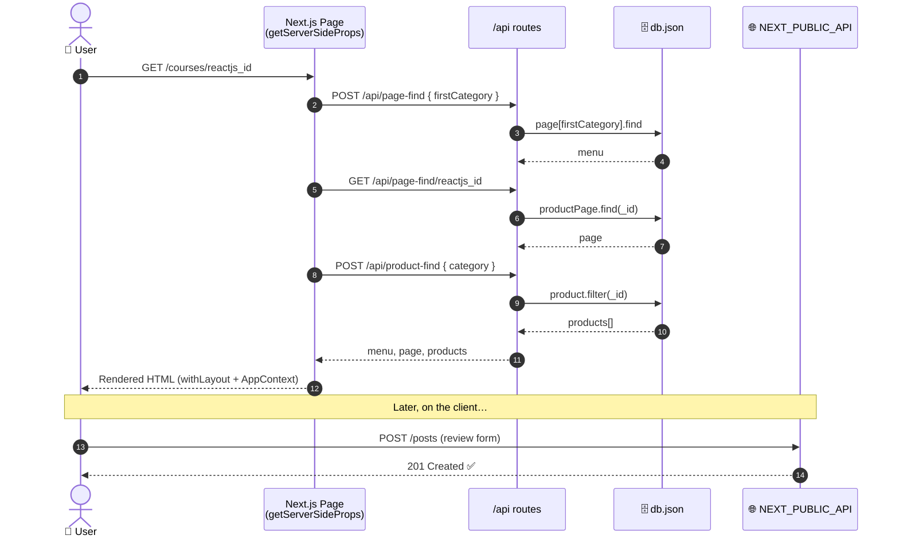
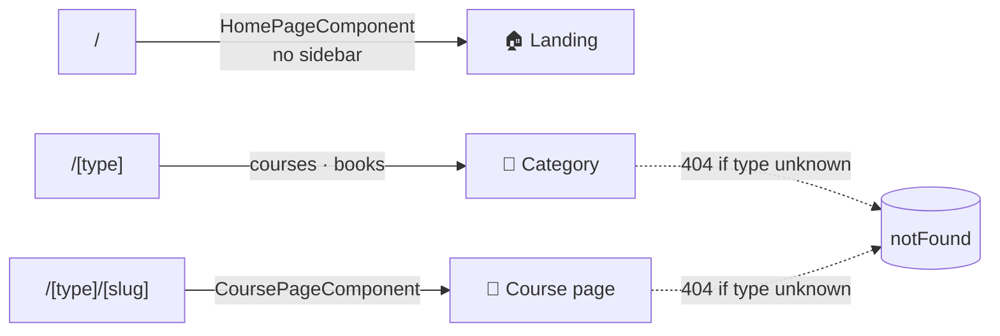
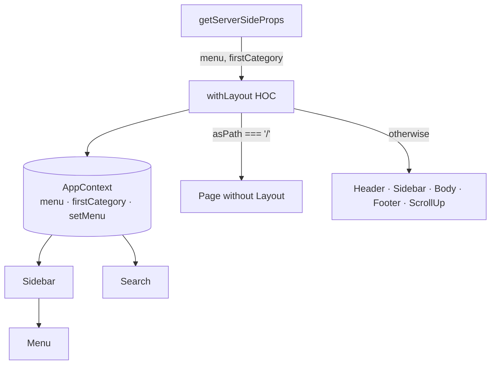
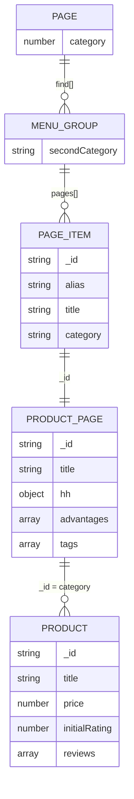

<div align="center">


# Sammi Academy — Client

**An online course catalog built with Next.js, TypeScript and CSS Modules.**
Browse courses and books by category, sort them by rating or price, see job-market salary data, and leave reviews.

[](https://nextjs.org/)
[](https://react.dev/)
[](https://www.typescriptlang.org/)
[](https://storybook.js.org/)
[](https://www.framer.com/motion/)
[](https://react-hook-form.com/)


[🚀 Quick start](#-quick-start) •
[✨ Features](#-features) •
[🏗️ Architecture](#️-architecture) •
[🔌 API](#-api-reference) •
[🧩 Components](#-component-library) •
[📁 Structure](#-project-structure)

</div>

---

## 📑 Table of contents

<details open>
<summary><b>Click to collapse / expand</b></summary>

- [✨ Features](#-features)
- [🚀 Quick start](#-quick-start)
- [⚙️ Environment variables](#️-environment-variables)
- [📜 Scripts](#-scripts)
- [🏗️ Architecture](#️-architecture)
  - [Request flow](#request-flow)
  - [Routing](#routing)
  - [State and context](#state-and-context)
- [🔌 API reference](#-api-reference)
- [🗄️ Mock database (`db.json`)](#️-mock-database-dbjson)
- [🧩 Component library](#-component-library)
- [📚 Storybook](#-storybook)
- [📁 Project structure](#-project-structure)
- [🛠️ Tech stack](#️-tech-stack)
- [🗺️ Roadmap](#️-roadmap)
- [❓ FAQ / Troubleshooting](#-faq--troubleshooting)

</details>

---

## ✨ Features

| | Feature | Where it lives |
|:-:|---|---|
| 🏠 | **Landing page** with a hero section, partner logos and a "What we can teach you" timeline | [`home-page-component`](src/page-components/home-page-component/home-page-component.tsx) |
| 🗂️ | **Two-level menu** (Courses / Books → Programming, Design, Marketing…) | [`menu.tsx`](src/layout/menu/menu.tsx) |
| 🔎 | **Live search** across every page in the current menu | [`search.tsx`](src/components/search/search.tsx) |
| ↕️ | **Sorting** by rating or price, with spring animations | [`sort.reducer.ts`](src/page-components/course-page-component/sort.reducer.ts) |
| 💼 | **Job-market stats** (hh.uz vacancies and junior/middle/senior salaries) | [`hh-data.tsx`](src/components/hh-data/hh-data.tsx) |
| ⭐ | **Interactive star rating** with hover preview | [`rating.tsx`](src/components/rating/rating.tsx) |
| 📝 | **Review form** with validation (react-hook-form) | [`review-form.tsx`](src/components/review-form/review-form.tsx) |
| ⏳ | **Progress bar** between route changes (NProgress) | [`_app.tsx`](src/pages/_app.tsx) |
| ⬆️ | **Scroll-to-top** button driven by a custom `useScrollY` hook | [`useScrollY.ts`](src/hooks/useScrollY.ts) |
| 🔍 | **SEO** meta tags from a single config | [`site.config.ts`](src/config/site.config.ts) |
| 📚 | **Storybook** to develop components on their own | [`.storybook/`](.storybook/) |

---

## 🚀 Quick start

> [!IMPORTANT]
> You need **Node.js 18+** and **npm**. The app is self-contained: its API routes read from the bundled `db.json`, so you don't need a separate backend to run it.

```bash
# 1. Clone and enter the project
git clone https://github.com/dilshodbek-swe/md-education sammi-client
cd sammi-client

# 2. Install dependencies
npm install

# 3. Create your env file (see the next section)
# create .env.local (see the next section)

# 4. Start the dev server
npm run dev
```

Then open **<http://localhost:3000>** 🎉

<details>
<summary>🧪 <b>Try these URLs once it's running</b></summary>

| URL | What you'll see |
|---|---|
| `/` | Landing page (no sidebar) |
| `/courses/reactjs_id` | ReactJS course list, salary stats and skills |
| `/courses/nextjs_id` | NextJS course list |
| `/books/...` | Book categories (pick one from the sidebar) |
| `/api/product-find` (POST) | Raw JSON from the mock API |

</details>

---

## ⚙️ Environment variables

Create a `.env.local` file in the project root:

```env
# Base URL of this Next.js app. getServerSideProps uses it to call its own /api routes
NEXT_PUBLIC_DOMAIN=http://localhost:3000

# External API that review submissions are POSTed to (`${NEXT_PUBLIC_API}/posts`)
NEXT_PUBLIC_API=https://jsonplaceholder.typicode.com
```

| Variable | Required | Used in | Purpose |
|---|:-:|---|---|
| `NEXT_PUBLIC_DOMAIN` | ✅ | `src/pages/**` | Server-side data fetching from the internal API |
| `NEXT_PUBLIC_API` | ✅ | `review-form.tsx` | Review submission endpoint (expects `201 Created`) |

> [!WARNING]
> When you deploy, set `NEXT_PUBLIC_DOMAIN` to the deployed URL (for example `https://sammi.ac`). Otherwise the server-side requests will try to reach `localhost` and fail.

---

## 📜 Scripts

| Command | Description |
|---|---|
| `npm run dev` | Start the dev server at `:3000` with hot reload |
| `npm run build` | Make a production build |
| `npm start` | Serve the production build |
| `npm run lint` | Run ESLint (TypeScript rules) |
| `npm run storybook` | Open Storybook at `:6006` |
| `npm run build-storybook` | Build Storybook as a static site |

---

## 🏗️ Architecture

### Request flow

Every page is rendered on the server. `getServerSideProps` calls the app's own API routes, and those routes read from `db.json`:



### Routing



<details>
<summary><b>How <code>[type]</code> maps to a category</b></summary>

`[type]` is matched against `firstLevelMenu` in [`constants.tsx`](src/helpers/constants.tsx):

| Route | `PageCategory` enum | id |
|---|---|:-:|
| `courses` | `PageCategory.Courses` | `0` |
| `books` | `PageCategory.Books` | `1` |

Any other value returns a **404**.

</details>

### State and context



- **`withLayout`** ([`layout.tsx`](src/layout/layout.tsx)) wraps every page in `AppContextProvider` and adds the full layout everywhere except `/`.
- **`AppContext`** ([`app.context.tsx`](src/context/app.context.tsx)) holds the menu tree so the **Menu** and **Search** components share it without prop drilling.
- **Sorting** uses a `useReducer` with the `Rating`, `Price` and `reset` actions.

---

## 🔌 API reference

All routes live in [`src/pages/api`](src/pages/api) and read from `db.json`.

<details>
<summary><code>POST</code> <b>/api/page-find</b> — get the menu for a top-level category</summary>

**Body**

```json
{ "firstCategory": 0 }
```

**Response** — `IMenuItem[]`

```json
[
  {
    "_id": { "secondCategory": "Programming" },
    "pages": [
      { "alias": "react-js", "title": "ReactJS Courses", "_id": "reactjs_id", "category": "ReactJS" }
    ]
  }
]
```

**Try it**

```bash
curl -X POST http://localhost:3000/api/page-find \
  -H "Content-Type: application/json" \
  -d '{"firstCategory":0}'
```

</details>

<details>
<summary><code>GET</code> <b>/api/page-find/:id</b> — get a single page (title, hh stats, advantages, tags)</summary>

**Response** — `IPage`

```ts
interface IPage {
  _id: string
  alias: string
  title: string
  category: string
  tags: string[]
  description: string
  hh: { count: number; juniorSalary: number; middleSalary: number; seniorSalary: number }
  advantages: { id: string; title: string; description: string }[]
}
```

**Try it**

```bash
curl http://localhost:3000/api/page-find/reactjs_id
```

</details>

<details>
<summary><code>POST</code> <b>/api/product-find</b> — get the products (courses) in a category</summary>

**Body**

```json
{ "category": "reactjs_id" }
```

**Response** — `IProduct[]` (title, price, oldPrice, credit, images, initialRating, reviews, advantages, characteristics…)

**Try it**

```bash
curl -X POST http://localhost:3000/api/product-find \
  -H "Content-Type: application/json" \
  -d '{"category":"reactjs_id"}'
```

</details>

> [!NOTE]
> Bad input returns `400`. Requests with any other HTTP method get no response, so the request hangs.

---

## 🗄️ Mock database (`db.json`)



| Collection | Records | Description |
|---|:-:|---|
| `page` | 2 | Top-level categories (Courses, Books) and their menu groups |
| `productPage` | 62 | Category landing data (salary stats, advantages, skills) |
| `product` | 248 | Individual courses and books |

Menu groups include **Programming, Design, Marketing, Copywriting and Games**.

---

## 🧩 Component library

All UI components are exported from [`src/components/index.ts`](src/components/index.ts). Each one follows the same pattern:

```
component-name/
├── component-name.tsx         # the component
├── component-name.props.ts    # typed props (extends native HTML attrs)
├── component-name.module.css  # scoped styles
└── *.svg                      # icons, imported as React components via SVGR
```

<details>
<summary><b>🎛️ View all 18 components</b></summary>

| Component | Key props | Notes |
|---|---|---|
| `Button` | `appearance: primary · ghost · failure · success`, `arrow: right · down · none`, `size: s · m · l` | Has a Storybook story |
| `IconButton` | `icon: close · menu · up`, `appearance: primary · white` | Used for the mobile menu and scroll-up |
| `Heading` | `tag: h1 · h2 · h3` | |
| `Text` | `size: s · m · l` | |
| `Tag` | `size: s · m`, `color: primary · danger · success` | |
| `Card` | `color: white · primary` | |
| `Divider` | — | |
| `Input` | `error` | `forwardRef` for react-hook-form |
| `TextArea` | `error` | `forwardRef` |
| `Rating` | `rating`, `isEditable`, `setRating`, `error` | `forwardRef`, works with react-hook-form `Controller` |
| `Sort` | `sort`, `setSort` | `SortEnum.Rating` / `SortEnum.Price` |
| `Search` | — | Reads the menu from `AppContext` |
| `Product` | `product` | Wrapped in Framer Motion `motion()` for layout animations |
| `Review` | `review` | Not exported from `index.ts`; imported directly by `Product` |
| `ReviewForm` | `productId` | Shows success and error panels |
| `HhData` | `count`, `juniorSalary`, `middleSalary`, `seniorSalary` | |
| `Advantages` | `advantages` | |
| `ScrollUp` | — | Appears based on `useScrollY` |

</details>

**Example**

```tsx
import { Button, Heading, Tag } from '@/components'

export const Example = () => (
  <>
    <Heading tag='h2'>Vacations — ReactJS</Heading>
    <Tag color='danger' size='m'>hh.uz</Tag>
    <Button appearance='primary' arrow='right'>Join For Free</Button>
  </>
)
```

---

## 📚 Storybook

```bash
npm run storybook   # → http://localhost:6006
```

- Uses a custom theme from [`.storybook/sammi-theme.ts`](.storybook/sammi-theme.ts)
- Includes the `essentials`, `onboarding`, `chromatic` and `experimental-addon-test` addons
- Imports SVGs through `@svgr/webpack`, the same way the app does

> [!TIP]
> Only `Button` has a story so far. To add one, create `<component>.stories.tsx` next to the component and Storybook will find it automatically.

---

## 📁 Project structure

<details>
<summary><b>Click to expand the file tree</b></summary>

```
client/
├── .storybook/            # Storybook config + custom theme
├── public/                # Static assets (hero.png, skill.png)
├── db.json                # Mock database (pages, productPage, product)
├── next.config.js         # SVGR loader, remote image domains
└── src/
    ├── components/        # 18 reusable UI components
    ├── config/            # site.config.ts — SEO metadata
    ├── context/           # AppContext (menu + firstCategory)
    ├── helpers/           # constants, formatters (convertToUSD), brand icons
    ├── hooks/             # useScrollY
    ├── interfaces/        # IMenuItem, IPage, IProduct, enums
    ├── layout/            # Header, Sidebar, Menu, Navbar, Footer, Seo, withLayout
    ├── page-components/   # HomePageComponent, CoursePageComponent (+ sort reducer)
    ├── pages/
    │   ├── api/           # page-find, page-find/[id], product-find
    │   ├── [type]/        # /courses, /books, /[type]/[slug]
    │   ├── _app.tsx       # Global CSS + NProgress
    │   └── index.tsx      # Landing page
    └── styles/            # global.css
```

</details>

---

## 🛠️ Tech stack

<table>
<tr>
<td valign="top" width="33%">

**Core**
- Next.js 13 (Pages Router)
- React 18
- TypeScript 5
- CSS Modules

</td>
<td valign="top" width="33%">

**Libraries**
- axios — HTTP
- react-hook-form — forms
- framer-motion — animations
- date-fns — dates
- nprogress — route progress bar
- react-icons, react-event-timeline
- classnames

</td>
<td valign="top" width="33%">

**Tooling**
- Storybook 8
- ESLint + `@typescript-eslint`
- SVGR (`@svgr/webpack`)

</td>
</tr>
</table>

---

## 🗺️ Roadmap

- [x] Landing page with timeline
- [x] Two-level category menu
- [x] Course list with sorting and animations
- [x] hh.uz salary stats
- [x] Review form with validation
- [x] Live search
- [x] Storybook setup
- [ ] Real content for the `/[type]` category page (it currently shows a placeholder)
- [ ] Connect a real backend (Node / Express / MongoDB) to replace `db.json`
- [ ] Stories for every component
- [ ] Unit tests (Jest + React Testing Library)
- [ ] Deploy

---

## ❓ FAQ / Troubleshooting

<details>
<summary><b>Every page fails with <code>ECONNREFUSED</code> / <code>AxiosError</code></b></summary>

`NEXT_PUBLIC_DOMAIN` is missing or points to the wrong place. It must match the URL where the app is running (for example `http://localhost:3000`). If port 3000 is taken, Next.js starts on 3001 and the server-side requests break, so update the variable or free the port.

</details>

<details>
<summary><b>SVG imports show errors or render as <code>[object Object]</code></b></summary>

SVGs are loaded as React components through `@svgr/webpack` (see [`next.config.js`](next.config.js)). Make sure dev dependencies are installed with `npm install`, and import them as components: `import Icon from './icon.svg'` → `<Icon />`.

</details>

<details>
<summary><b>Submitting a review says "Something went wrong!"</b></summary>

The form only shows success when the API returns **`201`**. Check that `NEXT_PUBLIC_API` is set. The default `https://jsonplaceholder.typicode.com/posts` returns `201` but doesn't save anything.

</details>

<details>
<summary><b>Images from a remote URL don't load</b></summary>

Only `media.graphassets.com` is allowed in `next.config.js` → `images.domains`. Add your host there.

</details>

---

<div align="center">

Made with ❤️ by **Dilshodbek Gulomov** • Sammi Academy

<sub>⭐ If this project helped you, give it a star!</sub>

</div>
